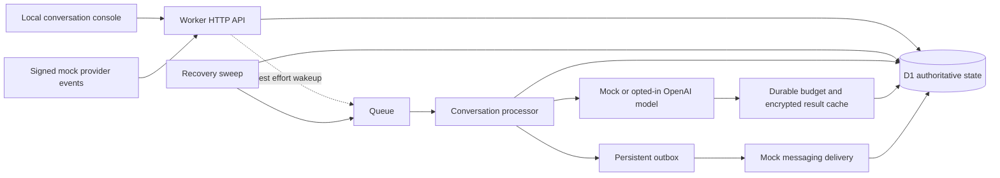

# Plause architecture

## Product boundary

Plause is a personal AI agent whose primary conversation lives in Apple Messages. The backend owns identity, conversation state, model calls, tools, and delivery. The messaging provider is a replaceable transport. A browser account surface supports authentication, linking, controls, and operational fallback; the current running preview uses mock providers.

The backend runs with local Cloudflare emulation and a signed mock messaging adapter. It supports explicit encrypted saved facts, durable reminders, exact approvals, a simulated calendar, account export/erasure, a deterministic mock model, and optional OpenAI and Tavily adapters. Provider requests require explicit configuration. Current model and search configuration remain disabled; Apple/MSP messaging is not connected.

## Components

| Area | Location | Responsibility |
| --- | --- | --- |
| API and processing | `apps/api/src/` | Authentication, ownership checks, event ingestion, conversation processing, delivery, recovery |
| Development console | `apps/api/public/` | Invitation login, transcript, composer, state polling, support controls |
| Contracts | `packages/contracts/` | Validated normalized events, channel subjects, message content, send outcomes, provider interfaces |
| Agent core | `packages/agent-core/` | Deterministic mock model, recent context, support recognition, explicit memory command grammar and credential guard |
| Saved memory | `apps/api/src/memory-store.ts` | Encrypted account facts, deterministic control plans, atomic changes/acknowledgments, history resets and privacy fences |
| Hosted model | `packages/models-openai/` | Text-only Responses API adapter, exact input-token preflight, request deadline, strict output/usage validation |
| Hosted runtime | `apps/api/src/model-runtime.ts` | Atomic budget reservations, attempt tombstones, encrypted result cache, dispatch authorization |
| Scheduling | `packages/scheduling/`, `apps/api/src/reminder-store.ts` | DST-aware next occurrence and quiet hours, atomic occurrence/outbox creation, cancellation and delivery fences |
| Approvals | `apps/api/src/action-store.ts` | Immutable argument digests, scope/revision/expiry checks, atomic one-use approval consumption |
| Research | `packages/research/`, `apps/api/src/research.ts` | Explicit-query external disclosure, fixed-origin search, source validation, daily request caps and result recovery |
| Accounts and operations | `apps/api/src/account.ts`, `operations.ts` | Scoped export/erasure, conservative usage and aggregate health counters |
| Mock channel | `packages/messaging-mock/` | Local messaging behavior behind the delivery boundary |
| Security | `packages/security/` | Content encryption, secret comparison, hashing, webhook verification |
| Schema | `migrations/` | Durable users, bindings, sessions, inbox/work, conversations, messages, and outbound state |

D1 is authoritative. Queues carry opaque conversation references and wake processors; successful queue publication is not required for accepted work to remain recoverable. No Durable Object or Agents SDK is introduced in this slice. Add runtime machinery when a measured requirement justifies it.

## Inbound acceptance and processing

1. Validate the request shape, size, origin or provider signature, and supported channel. Route a provider/business/subject tuple through a trusted binding. An inbound payload cannot choose its own internal user identity.
2. Recognize exact whole-message memory, reminder and action controls and prepare a revision-scoped deterministic plan. Persist the deduplicated inbound event, message, pending state, mutation, and deterministic acknowledgment atomically when applicable. Repeated provider events or browser client IDs cannot repeat a mutation. Controls complete without a model call.
3. Attempt a queue wakeup. If it fails, the durable pending state remains eligible for recovery.
4. For ordinary conversation, claim work under a bounded lease and load account-scoped recent history plus enabled saved facts. Exclude memory-control turns, respect the user's current history boundary, and fence the account context revision. Call the model adapter and persist the generated reply and outbound work before delivery.
5. Check current conversation state and delivery gates immediately before outbound dispatch. Record the send result, provider message identifier when known, and subsequent delivery events.

The scheduled recovery path creates due reminder occurrences and finds durable work whose wakeup was lost. The development wrapper explicitly triggers the local scheduled-event endpoint every 15 seconds after checking the local/mock environment, because Wrangler does not automatically execute cron. Production needs monitoring for pending age and repeated failures. A passing local demo does not prove production queue, scheduler, or provider behavior. See [Cloudflare's local cron testing](https://developers.cloudflare.com/workers/configuration/cron-triggers/).

## Explicit saved memory

Users can save at most 10 facts of 300 UTF-16 units each through complete, single-line commands. There is no automatic extraction or model-authored memory write. The deterministic parser rejects malformed/quoted/embedded commands and conservatively rejects credential-like fact content. A rejected command remains in the encrypted transcript; this guard does not redact messages or detect every sensitive fact.

Facts and the on/off setting belong to the internal user across their channels. `GET /api/memories` and the JSON export derive scope from the authenticated cookie. Turning memory off retains encrypted facts, excludes them from model context, and blocks save/edit; list/export/forget remain available. Controls bypass normal chat quota and model-readiness gates, do not spend model budget, and can apply during human support without restarting the bot. Their acknowledgments are recorded `local_only` while human mode is active.

Every effective mutation advances an account context revision, cancels older pending input/outbox work across channels, invalidates leases, and purges or fences old hosted caches while retaining possible-charge metadata. Forget/edit/off/on also set a new future-history boundary; save keeps completed recent history. Model dispatch, result persistence, and outbound paths check the current revision, so stale generation cannot commit or revive old context. An already accepted external request/send can still incur charges or arrive; uncertainty is recorded instead of promising recall.

Earlier transcripts and delivered replies remain. Memory controls and acknowledgments are excluded from model history, and resetting the boundary prevents older conversation facts from being silently reintroduced into future prompts. Production source-message deletion, backups, retention, and model-provider policies remain separate obligations. See [saved memory](saved-memory.md) for commands, export, and limits.

Privacy/settings controls use scoped metadata when the fact value itself is corrupt, preserving a way to correct, forget, or disable memory. Listing, export, and model-context reads fail closed instead of returning broken content. Old unknown send outcomes remain visible and cannot be resent after the context revision changes; they do not prevent a new privacy-control acknowledgment or later eligible conversation work.

## Hosted generation and cost accounting

Hosted generation requires a validated local, staging or production runtime, `MODEL_PROVIDER=openai`, explicit `LIVE_MODEL_ENABLED=true`, a private API key, and a valid policy. The configuration CLI uses a hidden terminal prompt or protected key file and atomically updates `.dev.vars` without replacing unrelated secrets. It does not call the provider. Public health reports configuration readiness, not credential or model-access verification.

The adapter uses the Responses API input-token endpoint before generation. It sends bounded recent history, the current message, and saved facts only when memory is enabled. Facts are explicit data, not authorization or new system instructions. It offers strict bounded draft functions and a read-only calendar request, disables parallel calls and stored provider state with `store:false`, and validates model, service tier, usage, completion, body size, text and structured arguments. The server alone validates authority, publishes exact reviews and executes approved work. See [model proposals](model-proposals.md). It performs no provider retries. Prompt instructions require honest capability limits; this remains a model-behavior requirement to evaluate with real responses.

Before billable dispatch, D1 atomically reserves a conservative maximum request cost against both user and global UTC monthly allowances. Defaults are 4,096 input tokens, 600 output tokens, US$5 per user/month and US$50 globally/month. The runtime policy uses US$0.25/input-million and US$0.50/output-million as upper estimates for the selected `gpt-6-luna` model, covering the reviewed short-context input/cache-write rates; these are accounting bounds, not exact invoice rates. Source checked 2026-10-30: [OpenAI API pricing](https://developers.openai.com/api/docs/pricing).

A durable `model_attempts` record permits at most one hosted generation attempt per accepted input. Model input digests reject conflicting reuse. Ownership, active binding/user, content hash, conversation mode/status, outbound pause, and unexpired lease are rechecked before dispatch. Reply/outbox commits remain fenced by the current conversation ownership. Recent history is ordered by logical input/reply relationships so a delayed answer belongs to its original turn.

Validated completed output is encrypted and cached before the reply/outbox transaction. Recovery can reuse it after a crash between those commits without paying for another generation. Known outcomes settle the reservation using recorded usage and the conservative rate policy. Unknown outcomes keep the maximum debit held. Provider invoices remain authoritative; there is no automatic refund or retry after uncertain dispatch and no operator reconciliation endpoint yet.

The adapter's default deadline is 20 seconds, with a five-second processor grace period for persistence inside a 60-second lease. An overall timeout terminally fails that input and requests cancellation. A response that completes after the terminal cutoff may leave a cached/accounted result, but it is intentionally not automatically resurrected or delivered; an operator must inspect the outcome. A cache does not establish that the customer received a reply.

Minimal model-attempt cost metadata survives transcript/account erasure so deletion cannot reset a possibly charged allowance. Source deletion purges encrypted cached content and its input digest. The local account-erasure endpoint requires invitation reauthentication, an exact phrase and a separate one-use confirmation; cloud identity and independent erasure replay are implemented; live provider, retention/cutover policy and operator billing reconciliation still need acceptance.

## Outbound delivery

Acceptance, sending, and delivery are different states. A provider timeout can mean a message was accepted even though no response reached Plause. `delivery_unknown` must remain visible and must not trigger blind retries. The Sunshine adapter reconciles with GET-only metadata/content checks; it does not claim provider POST idempotency.

Normalized event types distinguish received messages, delivery updates, conversation closure, and handoff requests. Event deduplication is separate from message deduplication so a delivery update for an existing message remains meaningful. Structured text, URL links and server-issued quick replies are implemented in the Sunshine adapter; the web console renders safe text and exact approval controls. These contract types do not establish Apple production readiness.

Conversation closure and support takeover are durable gates. Pending automated sends must be suppressed when a conversation closes or enters human mode. The Sunshine adapter maps authenticated provider lifecycle events into these gates; controlled races pass, and actual provider/device cancellation acceptance remains outstanding.

## Identity and authorization

An internal user owns the data. A channel binding associates that user with a scoped opaque external subject. The identity tuple includes provider, business, and subject. Phone numbers are not primary keys, and untrusted webhook text is not an account-linking instruction.

Local setup seeds fictional Alex and Sam accounts and mock channel bindings. A hashed invitation token creates an expiring session; the cookie is HttpOnly and SameSite Strict. State-changing browser requests require the same origin. Each conversation lookup checks the session user's ownership before reading or writing. Bearer operator access is a local-only fixture. Cloud staff require fresh verified identity and a durable role.

Cloud account linking uses a fresh verified session, expiring single-use channel proof and same-session explicit confirmation. Active destinations are unique; subject reassignment is rejected. Relinking fences old work and claims before replacing a destination. See the identity/support guide for the exact flow.

## Content and secrets

Message content, saved fact text, and completed hosted-response caches are encrypted with Web Crypto before D1 storage. Routing identifiers, state, revisions, and operational metadata remain queryable. The local content encryption key is generated during setup and stored outside version control. This is application-level storage encryption, not end-to-end encryption: the backend decrypts content to process conversations, and an explicitly enabled hosted model receives the bounded prompt, recent context, and enabled saved facts.

Invitations and session tokens are hashed in the database. Provider webhook signatures are checked against the raw request body. API errors avoid logging raw message bodies, tokens, or exception contents. Production still requires key management and rotation, retention rules, deletion verification, backup treatment, redaction, and access auditing.

## Support and future capabilities

An exact support intent such as `help`, `agent`, or `support` switches to human mode. The model must not continue replying during human takeover. The local resume control is a development capability; the cloud staff path implements authenticated ownership/replies/resume, while actual staffing and coverage remain operational acceptance.

Saved memory, reminders, explicit source-linked research, scoped calendar actions and exact approvals are implemented locally. The optional hosted model can request bounded calendar reads or draft one action for server review. Model output cannot grant permission. All external writes require exact scoped approvals, current grants and truthful verified outcomes; uncertain results are never blindly repeated. Retrieved/calendar text remains untrusted and private facts/history never become automatic search arguments. Automatic memory extraction, third-party messages, purchases and autonomous browsing remain outside this implementation. Proactive Apple delivery stays off until channel policy permits it. See [reminders](reminders.md), [actions](actions.md), [research](research.md) and [Google Calendar](google-calendar.md).

## Validation boundary

Current suite, versioned migrations, dry-run and mock smoke results are recorded in [the handoff](../HANDOFF.md). Tests use controlled model responses, including saved-fact context and privacy races. Hosted evaluation refuses before dispatch while actual configuration remains mock mode without a key. A Wrangler dry run only verifies bundling; no deployment occurred.

Browser visual/interaction QA remains unverified because the browser URL security policy blocked the local page. Real hosted usefulness and usage reconciliation, Apple eligibility, MSP behavior, live messaging delivery, human support operations, production recovery, and real-device acceptance are separate milestones.

## Cloud integration, identity and operations

The current implementation adds Google OIDC identity, two-sided provider channel linking, an approved-configuration-only Sunshine Conversations Apple adapter and authenticated web delivery. Provider control, binding revision/destination, consent, account context, lease and ownership epochs fence consequential work. Provider timestamps maintain a replay boundary across enrollment/relink; lifecycle events can close or take ownership before the first message. Handoff suppresses generated responses, while a fresh-role/leased-claim staff path can send separately attributed replies under current Plause provider control.

Production rejects mock model/messaging and uses explicit HTTPS origins and environment-isolated resources. Authenticated web is available before Apple approval. `GET /ready` exposes configuration state without claiming live acceptance. Generated Cloudflare configurations include separate D1, queues, a consumed DLQ, private R2 erasure ledger, cron and redacted structured observability. Setup/provisioning/credentials/deployment remain explicit external actions.

Account erasure records an independent immutable R2 tombstone before live content purge. Restore artifacts remain offline, closed, authenticated access cleared, outbound paused and restore-locked. Versioned encryption keys preserve legacy ciphertext and authenticate key IDs. Bounded retention clears safely terminal webhook payloads while preserving replay tombstones and uncertain/charged metadata. Atomic signup/API limits and provider circuits bound abuse and outages. See [cloud deployment](cloud-deployment.md), [identity/support](identity-and-support.md), [privacy/restore](privacy-and-restore.md), [key rotation](key-rotation.md) and the current [handoff](../HANDOFF.md) for tested source and remaining external gates.
